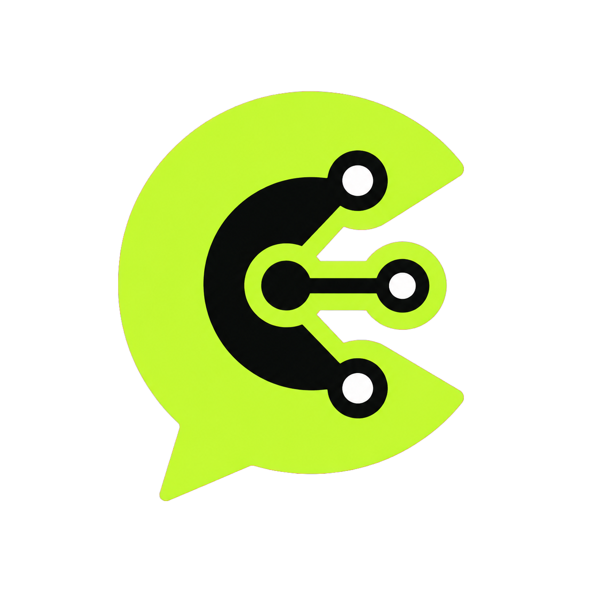

  

# ChudOS

**Gorilla Tag mod menu — made by Astra.**

ChudOS is a customizable mod menu for **Gorilla Tag on Windows PCVR**, with an in-game VR menu and mouse controls on desktop. Movement tools, player visuals, rig mods, music, macros, and local holdables are brought together in one menu.

**V0.1.5 Final includes 597 menu buttons**, covering mods, settings, and actions. The total includes **284 toggles outside Settings, 78 actions, 11 selectors, and 224 Settings entries**.

[Download V0.1.5](https://github.com/ASTRA228b/ChudOS/releases/tag/v0.1.5) · [Full button list and menu notes](MENUNOTES.md)

## What's in the menu

- **Jarvis:** spoken local menu commands, GPT Jarvis, and ChudGPT Jarvis with 14 model choices. Say the selected wake word, wait for the tone, then speak.
- **Movement:** platforms, flight, Wall Walk, Spider Man, Long Arms, Pull Mod, and more.
- **Visuals and players:** name tags, highlights, tracers, particles, voice level bars, and an information overlay.
- **Rig:** poses, animations, and player-targeting guns.
- **Practice and effects:** local physics toys, traversal tools, projectile previews, and a dedicated Spammers category.
- **Optimize Game:** a reversible low-quality graphics toggle under Visuals.
- **Soundboard:** local and microphone playback, music controls, audio downloads, F9/controller bindings, and desktop media controls.
- **Macros:** record and replay movement, manage saved routes, and import supported macro files.
- **Customization:** built-in and JSON custom themes, gradients, pressed colors, fonts, alignment, languages, sounds, vibrations, and custom boards.
- **Holdables:** twelve premade models, including Wooden Cross, Bisexual Flag, Gay Pride Flag, and Trans Flag. Cameras, toys, a flashlight, and a measuring tape are also included. Custom visual bundles are optional.
- **Discord Rich Presence:** ChudOS activity details, the ChudGPT logo, elapsed time, and download/source buttons. It turns itself off with a notification if Discord is unavailable.
- **OP:** mode-dependent Guardian/team controls and locally owned Lucy tools, with ownership and availability requirements.

Search for buttons, save favorites, and use the array list to see enabled mods. Settings lets you customize the menu and individual mods without editing source code.

## Installation

1. Set up BepInEx for the Windows PC version of Gorilla Tag.
2. Download **ChudOS-v0.1.5.zip** from the [v0.1.5 release](https://github.com/ASTRA228b/ChudOS/releases/tag/v0.1.5).
3. Remove previous ChudOS DLL copies from `BepInEx/plugins`, including subfolders. Extract the ZIP's **ChudOS** folder into `Gorilla Tag/BepInEx/plugins`.
4. Keep the included Discord runtime DLLs beside `ChudOS.dll`, then restart Gorilla Tag.

The standalone DLL asset is also available, but it needs the runtime files included in the install ZIP. See [Discord setup and runtime files](Docs/DiscordPresence.md).

## Open the menu

- **VR:** press the **left controller's secondary button** — Y on Quest-style controllers. Use the right-hand pointer to press buttons.
- **Desktop:** press **H** to open or close the menu, then click buttons with your mouse.

## Make it yours

Open **Settings → Custom Theme Editor** to paste theme JSON or use the RGB controls. Use **Apply** to accept the theme, **Save Theme** to save a shareable file, and **Save Menu State** to keep the active theme and settings after restarting.

Open **Main → SB Control** for music, **Movement → Macros GUI** for recordings, or **Main → Discord Rich Presence** to show your ChudOS activity. The rear menu label also includes the ChudGPT logo beside the version.

Voice recognition and external services depend on your setup and their availability. Map-specific and networked mods may require compatible game modes or loaded assets. Please report bugs with the button name and relevant log message.

For every button by category, individual controls, macro settings, and update history, see **[MENUNOTES.md](MENUNOTES.md)**.

## License

ChudOS is licensed under [GPL-3.0-only](LICENSE). Included runtime license notices are in [ThirdParty](ThirdParty).
